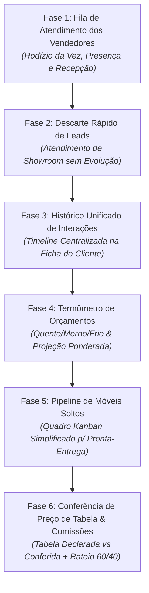

# Plano de Desenvolvimento Estruturado — Reunião de Alinhamento (05/Nov/2026)
## Projeto Plannit — Líder Móveis Planejados

> **Data de Elaboração:** 17 de Novembro de 2026  
> **Status:** Pronto para Execução  
> **Ordem de Prioridade:** Fila de Atendimento dos Vendedores como Marco Zero (Fase 1)

---

## 1. Visão Geral e Alinhamento Estratégico

Com base na transcrição da reunião de alinhamento realizada entre **Rafael Porto**, **Thiago Aguiar** e **Leandro Mantovani**, foram identificadas as necessidades de expansão operacional do **Plannit**. 

O objetivo principal desta nova etapa é **organizar e profissionalizar o atendimento presencial na loja física (porta/showroom)**, combater o constrangimento de recusas públicas de clientes, dar rastreabilidade ao tráfego do showroom e prover ferramentas gerenciais de previsibilidade de vendas e conferência de margens.

### Ordem de Desenvolvimento Priorizada

---

## 2. Fase 1 (Prioridade Imediata): Módulo de Fila de Atendimento dos Vendedores

### 2.1. Diagnóstico do Problema Operacional
- **Atrito na Recepção:** Quando clientes chegam à loja física sem agendamento prévio, a recepcionista precisa percorrer as mesas perguntando quem vai atender. Vendedores ocupados ou descompromissados recusam o atendimento na frente do cliente ("passa pro outro"), gerando constrangimento e impressão de desorganização.
- **Assimetria de Oportunidades:** Vendedores que chegam mais cedo acabam atendendo mais pessoas ao longo do mês do que aqueles que chegam tarde. Thiago precisa desse indicador numérico para cobrar metas e alinhar o desempenho individual.
- **Distinção de Conceito Arquitetural:** O Plannit já possui uma `/fila` (`FilaController`), que gerencia a **Fila Técnica de Projetistas 3D** (distribuição de briefings para desenhistas Promob com limite WIP). A nova funcionalidade trata do **Rodízio de Vendedores na Loja Física**, devendo operar sob o namespace `/atendimento/fila` ou `/recepcao/fila`.

---

### 2.2. Arquitetura e Modelagem de Dados

#### Tabela 1: `atendimento_fila_vendedores`
Representa o estado diário da fila de rodízio da loja física.
- `id` (PK, bigserial)
- `data`: date (data do dia do rodízio, renovada diariamente)
- `vendedor_id`: integer (FK `users.id`)
- `posicao`: integer (ordem na fila: 1 = próximo da vez, 2, 3...)
- `status`: varchar (enum: `disponivel`, `em_atendimento`, `ocupado_interno`, `pausa`, `ausente`)
- `motivo_indisponibilidade`: varchar (opcional: 'elaborando_orcamento', 'reuniao_projeto', 'almoco', 'outro')
- `hora_chegada`: timestamp with time zone (momento em que o vendedor marcou presença)
- `atendimentos_realizados_hoje`: integer (contador do dia)
- `created_at` / `updated_at`: timestamps

#### Tabela 2: `atendimento_registros`
Armazena cada atendimento presencial originado na recepção/porta.
- `id` (PK, bigserial)
- `data_hora`: timestamp with time zone
- `vendedor_id`: integer (FK `users.id` — quem atendeu)
- `recepcionista_id`: integer (FK `users.id` — quem despachou na recepção)
- `tipo_atendimento`: varchar (enum: `porta_novo`, `retorno_carteira`, `indicacao_especificador`, `outro`)
- `lead_id`: integer (FK `leads.id`, nullable caso seja lead novo gerado ou descarte rápido)
- `cliente_id`: integer (FK `clientes.id`, nullable)
- `arquiteto_id`: integer (FK `arquitetos.id`, nullable)
- `foi_pulo_de_vez`: boolean (indica se o vendedor não era o 1º da fila)
- `vendedor_pulado_id`: integer (FK `users.id`, nullable — quem era o próximo da vez que foi pulado)
- `justificativa_pulo`: text (obrigatório se `foi_pulo_de_vez` = true para cliente novo de porta)
- `duracao_minutos`: integer (nullable, preenchido na finalização)
- `status`: varchar (enum: `em_andamento`, `concluido`, `cancelado`)
- `observacao`: text (nullable)
- `created_at` / `updated_at`: timestamps

#### Tabela 3: `atendimento_historico_pulos` (Auditoria Imutável — RN017)
- `id` (PK, bigserial)
- `atendimento_registro_id`: integer (FK `atendimento_registros.id`)
- `vendedor_pulado_id`: integer (FK `users.id`)
- `vendedor_escolhido_id`: integer (FK `users.id`)
- `autor_id`: integer (FK `users.id` — recepcionista ou gestor)
- `motivo`: varchar (enum: `cliente_procurou_vendedor`, `parceiro_especificador`, `vendedor_recusou_corpo_mole`, `vendedor_ocupado_briefing`, `outro`)
- `justificativa_detalhada`: text
- `created_at`: timestamp with time zone

---

### 2.3. Regras de Negócio da Fila (RN-AT01 a RN-AT07)

1. **RN-AT01 (Ordem Matinal por Ordem de Chegada):**
   - No início do dia, a fila é montada conforme os vendedores marcam presença (botão *"Cheguei na Loja"* no painel do vendedor) ou através da montagem inicial pela Recepção/Gerente.
   - Quem chega primeiro fica na posição 1 (`posicao = 1`, Próximo da Vez).

2. **RN-AT02 (Status de Disponibilidade em Tempo Real):**
   - Vendedores podem alternar seu status entre `Disponível` e `Ocupado / Pausa`.
   - A recepcionista visualiza em tempo real um badge colorido (Verde = Disponível, Amarelo = Em Pausa/Orçamento, Azul = Em Atendimento).
   - O vendedor só é chamado automaticamente se estiver `Disponível`.

3. **RN-AT03 (Rotação Circular — Fim da Fila):**
   - Quando a recepcionista direciona um cliente para o vendedor nº 1 da fila, ele passa para `em_atendimento`.
   - Ao finalizar o atendimento (com geração de Lead, registro de retorno ou descarte rápido), esse vendedor vai automaticamente para a **última posição da fila** (`posicao = MAX(posicao) + 1`).
   - Os demais vendedores sobem uma posição (`posicao = posicao - 1`).

4. **RN-AT04 (Exceções de Pulo de Vez — Carteira e Especificador):**
   - Se o cliente entrar na loja procurando especificamente um vendedor (cliente de retorno da carteira dele) ou for trazido por um Arquiteto/Especificador vinculado àquele consultor, esse vendedor assume o atendimento imediatamente.
   - Nesses dois casos, o sistema registra `tipo_atendimento = 'retorno_carteira'` ou `'indicacao_especificador'`.
   - **Regra de Rodízio:** Atendimentos de carteira/especificador **não consomem** a vez do vendedor na fila de porta, mantendo-o em sua posição caso não esteja ocupado.

5. **RN-AT05 (Justificativa Obrigatória em Desvios de Fila):**
   - Se a recepcionista encaminhar um cliente **novo de porta** para alguém que não seja o 1º da fila disponível, o modal exige obrigatoriamente a seleção de um motivo e justificativa.
   - Isso inibe favorecimento por parte da recepção e audita recusas ("corpo mole") de vendedores disponíveis.

6. **RN-AT06 (Simplicidade e Agilidade Operacional):**
   - Conforme alinhado na reunião (atenção ao alerta de Leandro Mantovani: *"tomar cuidado para não problematizar um negócio simples"*), a interface deve permitir operação em **1 ou 2 cliques**:
     - Botão verde grande: `[Atender com Próximo da Vez (Fulano)]`.
     - Botão secundário: `[Selecionar Outro Vendedor / Justificar]`.

7. **RN-AT07 (Métricas e Relatórios Gerenciais):**
   - Relatório mensal disponível para Diretoria e Gerente Comercial:
     - Total de atendimentos no mês por vendedor (com separação entre clientes novos de porta vs. retornos de carteira).
     - Ranking de pulos de vez e motivos mais frequentes.
     - Taxa de conversão de atendimentos de porta em orçamentos e vendas concluídas.

---

### 2.4. Interfaces e Telas Propostas

1. **Painel da Recepção (`/atendimento/fila`):**
   - Card de destaque com o **Vendedor da Vez** (foto, nome, status, tempo desde o último atendimento).
   - Lista visual da fila organizada por posições (com suporte a drag-and-drop para reordenação excepcional pelo Gerente).
   - Ação rápida: `[Encaminhar Novo Cliente]` $\to$ Abre modal rápido para associar nome e telefone inicial do lead.
   - Tabela inferior com os atendimentos realizados no dia.

2. **Widget do Vendedor (Header ou Card no CRM):**
   - Badge no topo do sistema: *"Sua Posição na Fila: 2º da vez"* ou *"Você é o Próximo!"*.
   - Toggle simples: `[ Disponível / Ocupado ]` com menu de pausa rápida (ex: "Em reunião de projeto", "Fazendo orçamento").

3. **Configurações da Fila (`/configuracoes?tab=atendimento`):**
   - Parâmetros do rodízio: horário de abertura da fila matinal, motivos pré-cadastrados para pulo de vez e tempo de tolerância para retorno ao fim da fila.

---

## 3. Fase 2: Atalho para Leads sem Evolução (Showroom sem Conversão)

### 3.1. Contexto e Problema
Muitos clientes de showroom entram na loja física, fazem perguntas pontuais (ex.: perguntam se vende berço ou orçam um sofá e acham o preço fora da sua realidade) e saem sem iniciar um projeto. Hoje não há como cadastrar esse fluxo sem abrir o lead completo no CRM e cancelá-lo em seguida.

### 3.2. Solução Técnica
- **Ação no Modal "Novo Lead":** Adicionar checkbox `[ ] Atendimento não evoluiu (Descarte imediato de showroom)`.
- **Campos Condicionais:** Ao marcar, os campos de qualificação detalhada ficam ocultos e passam a ser exigidos apenas:
  - `Nome / Telefone` (opcionais caso o cliente não queira fornecer).
  - `Categoria procurada` (select: Berço/Infantil, Sofá, Cozinha, Quarto, Apenas conhecendo, etc.).
  - `Motivo do descarte` (catálogo gerenciável: Preço fora da expectativa, Produto não comercializado, Sem intenção de compra imediata, etc.).
- **Persistência:** O lead é gravado diretamente com status `descartado_showroom` / `perdido`, associado ao vendedor que o atendeu, alimentando os KPIs de tráfego de loja e inteligência de sortimento sem poluir o funil do CRM.

---

## 4. Fase 3: Histórico Unificado de Interações na Ficha do Cliente

### 4.1. Contexto e Problema
Thiago apontou que ao abrir a aba `/clientes` e acessar o cadastro de um cliente, não é possível ver o histórico unificado de interações realizadas (mensagens de WhatsApp, telefonemas, visitas ou reuniões), sendo necessário navegar manualmente pelos cards de projetos no CRM.

### 4.2. Solução Técnica
- **Página `/clientes/:id`:** Adicionar uma nova aba ou seção de timeline: **"Histórico de Interações & Atendimentos"**.
- **Agregação de Dados:** A query une registros de:
  - `interacoes_lead` (vinculadas aos leads daquele cliente).
  - `compromissos_agenda` (reuniões e visitas concluídas).
  - `atendimento_registros` (atendimentos presenciais da recepção).
  - `prontuario_clientes` (observações pessoais e comerciais).
- **Identificação Clara de Contexto:** Cada item da timeline exibe a data, o autor/responsável e uma tag indicando a qual projeto pertence (ex.: `Projeto PRJ-2026-001 - Cozinha`) ou se foi um contato geral.
- **Botão de Registro Rápido:** Permitir lançar uma nova interação direto da ficha do cliente sem precisar voltar ao CRM.

---

## 5. Fase 4: Termômetro de Orçamentos e Projeção de Vendas

### 5.1. Contexto e Regras
Classificação subjetiva da probabilidade de conversão do orçamento:
- **Quente (Alta Probabilidade):** Propenso a fechar no mês corrente (conversão padrão estimada em **70% a 80%**).
- **Morno (Média Probabilidade):** Propenso a fechar no mês seguinte (conversão padrão estimada em **30% a 35%**).
- **Frio (Baixa Probabilidade):** Sem pressa ou interesse distante (conversão padrão estimada em **5% a 10%**).

### 5.2. Solução Técnica
- **Campos no Lead / Orçamento:** Adição de `temperatura` (`quente`, `morno`, `frio`), `data_atualizacao_temperatura` e histórico imutável de transições.
- **Parametrização em `/configuracoes`:** Tabela de configuração com os percentuais de cálculo por temperatura, permitindo ao gestor ajustar as probabilidades históricas da loja.
- **Widgets de Dashboard:**
  - Card no `/dashboard` com o valor consolidado de orçamentos em aberto por temperatura.
  - Cálculo automático da **Projeção Ponderada do Mês**:
    $$\text{Projeção} = \sum (\text{Valor Orçado} \times \% \text{Probabilidade})$$
  - Filtro por vendedor e visão restrita (vendedor vê apenas sua carteira; gestores veem o consolidado da loja).

---

## 6. Fase 5: Pipeline & Quadro Kanban para Móveis Soltos

### 6.1. Contexto e Diferenciação do Negócio
O fluxo de móveis planejados sob medida é longo e técnico (briefing de obra, fila de promob 3D, render, handoff de fábrica). Já a venda de móveis soltos (sofás, mesas de jantar, poltronas) possui ciclo enxuto e não passa por engenharia de produção.

### 6.2. Solução Técnica
- **Aproveitamento da Infraestrutura Existente:** O Plannit já possui suporte nativo a múltiplos quadros via `kanban_quadros_catalogo` e `kanban_etapas_catalogo`.
- **Criação do Quadro "Móveis Soltos":**
  - Cadastro de novo quadro nativo no seed/banco.
  - Colunas simplificadas:
    1. *Atendimento Showroom / Interesse*
    2. *Seleção de Produtos / Especificação*
    3. *Orçamento Apresentado*
    4. *Negociação / Proposta*
    5. *Fechado / Aguardando Entrega*
    6. *Venda Concluída / Entregue*
    7. *Não Fechado / Perdido*
- **Regras Desacopladas:** Esse funil não exige preenchimento de Briefing Técnico nem bloqueios de aprovação de render 3D (RN004/RN005).

---

## 7. Fase 6: Gestão de Preço de Tabela, Descontos e Rateio de Comissões

### 7.1. Contexto e Problema
- Vendedores que inflacionam o preço de tabela para oferecer descontos nominais agressivos (ex: dar 40% de desconto fictício) sem sofrer corte de comissão.
- Necessidade de divisão de comissão quando há transferência de atendimento (férias, desligamento ou trabalho compartilhado).

### 7.2. Solução Técnica
- **Preço de Tabela Declarado vs. Conferido:**
  - No fechamento da proposta, o vendedor declara o `valor_tabela_declarado` e o `valor_fechado`.
  - A Gestora recebe o pedido em uma fila de validação gerencial e confere o preço oficial (`valor_tabela_conferido`), aprovando com 1 clique ou corrigindo o valor.
  - O sistema calcula o **Desconto Real Efetivo** para auditoria de margens.
- **Divisão e Rateio de Comissões:**
  - Regra padrão estipulada pela diretoria: **60% para quem digita/projeta o pedido** e **40% para quem fecha a venda**.
  - Suporte a personalização de percentuais por exceção no cadastro do fechamento.

---

## 8. Cronograma Sequencial Recomendado

| Etapa | Escopo | Entregáveis Técnicos |
| :--- | :--- | :--- |
| **Fase 1** | **Fila de Atendimento dos Vendedores** | Migrations de fila e registros, tela `/atendimento/fila`, toggle de status no Header/CRM, rotação automática e métricas da recepção. |
| **Fase 2** | **Descarte Rápido de Showroom** | Checkbox no modal Novo Lead, catálogo de motivos em Configurações e bypass do fluxo do CRM. |
| **Fase 3** | **Histórico Unificado na Ficha do Cliente** | Timeline de interações em `/clientes/:id`, unificando ligações, WhatsApp, visitas e projetos vinculados. |
| **Fase 4** | **Termômetro de Orçamentos** | Campos de temperatura, parâmetros de probabilidade em Configurações e cálculo ponderado no Dashboard. |
| **Fase 5** | **Quadro de Móveis Soltos** | Novo funil no seletor de quadros do CRM com etapas comerciais ágeis e sem travas de engenharia/render. |
| **Fase 6** | **Tabela Declarada vs Conferida & Comissões** | Gate gerencial de conferência de tabela, cálculo de desconto real e rateio 60/40 de comissões. |
