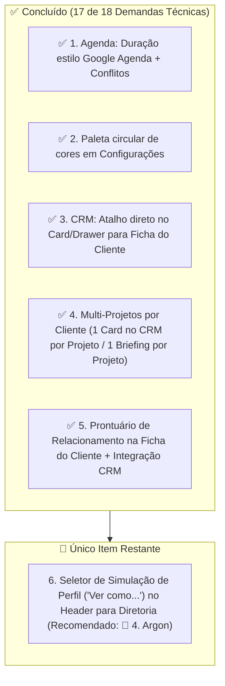

# Relatório Analítico de Implementação — Transcrições de Reuniões 📊

**Data de Emissão:** 22 de Outubro de 2026 (Atualizado após entregas das Sprints de Agenda, Ficha do Cliente e Multi-Projetos no CRM)  
**Fontes Analisadas:**
1. `Reunião iniciada às 2026_10_08 21_00 GMT-03_00 - Anotações do Gemini.md` (Participantes: Thiago Aguiar, Rafael Porto, Leandro Mantovani)
2. `Reunião iniciada às 2026_10_15 11_38 GMT-03_00 - Anotações do Gemini.md` (Participantes: Leandro Mantovani, Rafael Porto)
**Local do Relatório:** `.agents/plans/reunioes/relatorio_status_reunioes_implementacao.md`

---

## 🧭 Sumário Executivo

O cruzamento detalhado entre as decisões registradas nas transcrições das reuniões e a base de código atual do repositório (**AdonisJS v7 + Lucid ORM + Inertia React 19**) demonstra que **17 das 18 demandas técnicas já estão 100% implementadas**, incluindo:
- Consolidação do monólito na raiz e deploy automatizado no Railway;
- Parametrização dos 18 roteiros técnicos de briefing no banco de dados;
- Matriz dinâmica de permissões e perfis;
- Agenda com seletor de duração estilo Google Agenda + paleta circular de cores;
- Atalho direto no Card/Drawer do CRM para a Ficha do Cliente;
- Suporte completo a **Múltiplos Projetos por Cliente**, garantindo **1 Card independente no Kanban do CRM para cada Projeto** e **1 único Briefing por Projeto**;
- **Prontuário de Relacionamento do Cliente** na Ficha do Cliente com timeline por categorias e integração direta com o formulário de interações do CRM.

Resta atualmente **apenas 1 único item técnico de produto** no backlog: o **Seletor "Ver como..." no Header para a Diretoria**.

---

## 📊 Matriz de Rastreabilidade e Status das Demandas

| # | Funcionalidade / Decisão | Reunião | Status | Onde está no código / Situação Técnica |
|:---:|:---|:---:|:---:|:---|
| **01** | **Transcrição dos Guias Técnicos de Briefing (18 Manuais em PDF)** | 08/10 | ✅ Implementado | Tabelas `roteiros_briefings` e `roteiro_briefing_ambientes`, seeder completo, gaveta `RoteiroAmbienteDrawer.tsx` e editor em `/configuracoes`. |
| **02** | **Relatório de Tempo por Etapa do Funil (Modal de Retenção e Gargalos)** | 08/10 | ✅ Implementado | `ModalDetalhesTempoFunil.tsx` e `TempoColunasPanel.tsx`. Gravação de `tempo_permanencia_segundos` com testes em `leads_tempo_colunas.spec.ts`. |
| **03** | **Remoção da Linha do Tempo da Sidebar Lateral para Modal Dedicado** | 08/10 | ✅ Implementado | `ModalCompromissosLead.tsx` e `CompromissosLeadPanel.tsx` no CRM. |
| **04** | **Matriz Dinâmica de Permissões e Perfis (Configurações)** | 08/10 | ✅ Implementado | Aba "Perfis & Permissões" em `/configuracoes`, tabela `perfil_permissoes`, `PermissionService.ts` e testes em `permissoes.spec.ts`. |
| **05** | **Regra de Inativação de Perfis vs Inativação de Colaboradores** | 08/10 | ✅ Implementado | Inativação de perfil mantém usuários legados; inativação de colaborador bloqueia autenticação e acesso imediatamente. |
| **06** | **Correção do Bug do Briefing Técnico (Ativação de Ambientes do Catálogo)** | 08/10 | ✅ Implementado | `briefings_controller.ts` e `ambientes_catalogo` sincronizados dinamicamente via `catalogos.ts`. |
| **07** | **Remoção do Campo Estilo Preferido no Briefing** | 08/10 | ✅ Implementado | Briefing simplificado para referências visuais e observações livres na Seção 2. |
| **08** | **Título de Compromisso Opcional (Assume o Tipo do Catálogo)** | 08/10 | ✅ Implementado | No backend e validação: título ausente assume automaticamente o nome do tipo (`agenda_controller.ts`). |
| **09** | **Unificação do Repositório em Monólito na Raiz** | 15/10 | ✅ Implementado | Monólito transferido da subpasta `plannit/` para a raiz `/`, pastas legadas `backend/` e `frontend/` eliminadas. |
| **10** | **Preparação para Deploy Contínuo no Railway App** | 15/10 | ✅ Implementado | `Dockerfile` multi-stage, `docker-entrypoint.sh` (com migrations automáticas) e `railway.toml`. |
| **11** | **Reset / Substituição do PostgreSQL no Railway** | 15/10 | ✅ Implementado | Documentado com procedimentos passo a passo em `docs/deploy/railway_deploy_guide.md`. |
| **12** | **Deploy Automático por Merge na Branch `main`** | 15/10 | ✅ Implementado | Branch `main` sincronizada e configurada com webhooks do Railway. |
| **13** | **Agenda: Data/Hora de Término ➔ Seletor de Duração (Estilo Google Agenda)** | 08/10 | ✅ Implementado | Criado `SeletorDataHoraDuracao.tsx` com data única, hora de início/fim sincronizadas com duração (`15m`, `30m`, `1h`, `1h30`, `2h`...), opção "Dia inteiro", chips de local e detector de conflitos de agenda em tempo real nos 3 modais (`ModalNovoCompromisso`, `ModalEditarCompromisso`, `ModalReagendarCompromisso`). |
| **14** | **Paleta de Cores Circular para Tipos de Compromisso** | 08/10 | ✅ Implementado | Paleta circular estilo Google Calendar (12 cores + roda de cor personalizada + preview ao vivo do badge) em `inertia/pages/configuracoes/index.tsx`. |
| **15** | **Atalho no Card/Drawer do CRM para Abrir a Ficha do Cliente** | 08/10 | ✅ Implementado | Botão direto no `LeadCard` (`Ficha ↗`), no cabeçalho/barra de ações do `LeadDrawer` (`Ver Ficha do Cliente ↗`) e na tabela em lista do CRM, com resolução automática de ficha via `GET /crm/leads/:id/ficha-cliente` (`leads_controller.ts`). |
| **16** | **"Prontuário do Cliente": Observações Pessoais nas Interações & Parametrização em Configurações** | 08/10 | ✅ Implementado | Tabela `prontuario_clientes`, model `ProntuarioCliente`, seção visual `ProntuarioClienteSection.tsx` na Ficha do Cliente (`/clientes/:id`) com timeline por categorias, estrelas de destaque e checkbox no formulário de interações do `LeadDrawer` do CRM. Tabela `categorias_prontuario_catalogo` com CRUD e aba dedicada em `/configuracoes`, cores customizáveis, ícones e sincronização cross-tab em tempo real. Testes em `prontuario_cliente.spec.ts`. |
| **17** | **Associação de Múltiplos Projetos por Lead/Cliente (Cards Independentes)** | 08/10 | ✅ Implementado | Regra `1 Cliente ➔ N Projetos (1 Card no CRM por Projeto)` e `1 Projeto ➔ 1 Briefing Único`. Botões **`+ Novo Projeto p/ este Cliente`** no `LeadDrawer` (`POST /crm/leads/:id/novo-projeto`), **`+ Novo Projeto no CRM`** na Ficha do Cliente (`POST /clientes/:id/novo-projeto-crm`), seletor de cliente existente no `NovoLeadModal`, badge `PRJ-ANO-NNN` nos cards do Kanban e links **`Abrir Briefing ↗`** / **`Ver Projeto ↗`** na Ficha do Cliente. |
| **18** | **Seletor de Perfil no Header ("Ver como...") para Diretoria** | 08/10 | 🔴 Pendente | Header não possui mecanismo de alternância rápida de visualização para simular outros perfis (vendedor, projetista). |

---

## 🔍 Detalhamento do que Já Foi Implementado

### 1. Roteiros Técnicos de Briefing no Banco de Dados (Reunião 08/10)
- **O que foi pedido:** Transcrever os 18 manuais em PDF de ambientes da Líder Móveis para dentro do sistema, com perguntas estruturadas e respostas relacionadas.
- **Como foi entregue:**
  - Criação das tabelas relacionais `roteiros_briefings` (com seções dinâmicas em JSONB) e `roteiro_briefing_ambientes` (relação N:N, permitindo que um mesmo roteiro atenda múltiplos ambientes como "Quarto do Filho", "Quarto da Filha" e "Quarto de Visita").
  - Criação da gaveta lateral `RoteiroAmbienteDrawer.tsx` no Briefing, com inserção direta de títulos e itens na caixa de detalhamento do ambiente sem perda de rascunho.
  - CRUD administrativo completo com pesquisa e toggle na aba "Roteiros de Apoio" em `/configuracoes`.
  - Seeder com 100% dos dados dos 18 PDFs e suíte de testes em `roteiros_catalogo.spec.ts`.

### 2. Relatório de Permanência por Etapa do Funil (Reunião 08/10)
- **O que foi pedido:** Exibir o tempo total que o lead ficou no funil e porcentagens por etapa, identificando retornos e pontos de estagnação.
- **Como foi entregue:**
  - Criação de `ModalDetalhesTempoFunil.tsx` e `TempoColunasPanel.tsx`.
  - Backend registrando `tempo_permanencia_segundos` a cada mudança de status do lead.
  - Relatório visual com barras de progresso, indicação de maior retenção e dias/horas acumulados.

### 3. Matriz Dinâmica de Permissões & Perfis de Acesso (Reunião 08/10)
- **O que foi pedido:** Permitir que a Diretoria personalize permissões por perfil, ative/desative permissões específicas e crie novos perfis.
- **Como foi entregue:**
  - Tabela `perfil_permissoes` e `perfis_catalogo` com governança mestre irrevogável para Diretoria e `isSuperuser`.
  - Painéis `MatrizPermissoesPanel.tsx` e `UsuariosSistemaPanel.tsx` em Configurações.
  - 12 testes funcionais garantindo que inativação de perfil mantém usuários legados e exclusão só é permitida sem usuários associados.

### 4. Arquitetura Monolítica e Deploy Contínuo no Railway (Reunião 15/10)
- **O que foi pedido:** Resolver a divisão antiga de frontend/backend, consolidando em um monólito unificado na raiz e configurando o Railway.
- **Como foi entregue:**
  - Migração de `plannit/` para a raiz do repositório `/` e remoção total do legado (`backend/` e `frontend/`).
  - Criação do `Dockerfile` multi-stage em Node 24 Alpine, `railway.toml` e script `docker-entrypoint.sh` com migrations automáticas (`migration:run --force`).
  - Guia executivo de deploy e reset do banco em `docs/deploy/railway_deploy_guide.md`.

### 5. Agenda estilo Google Agenda + Paleta Circular de Cores (Reunião 08/10)
- **O que foi pedido:** Substituir o segundo campo manual de data/hora de término por seletor de duração estilo Google Agenda (`15m`, `30m`, `1h`, `1h30`, `2h`...), opção "Dia inteiro" e paleta circular de cores para Tipos de Compromisso.
- **Como foi entregue:**
  - Criação de `SeletorDataHoraDuracao.tsx` com seletor único de data, atalhos "Hoje"/"Amanhã", seletor de hora de início, seletor de hora de término com duração embutida (`13:00 (1 h)`), pílulas rápidas de duração, opção "Dia inteiro" (`08:00`–`18:00`) e verificador de conflito de agenda em tempo real.
  - Integração nos modais `ModalNovoCompromisso.tsx`, `ModalEditarCompromisso.tsx` e `ModalReagendarCompromisso.tsx`, além de chips rápidos de Local (`Showroom / Loja`, `Obra / Imóvel`, `Escritório Especificador`, `Reunião Online`).
  - Paleta circular de 12 cores + roda de cor personalizada e preview ao vivo do badge em `/configuracoes`.

### 6. Atalho Direto no CRM para a Ficha Completa do Cliente (Reunião 08/10)
- **O que foi pedido:** Permitir clicar em um atalho a partir do Kanban do CRM ou do Drawer do lead para abrir diretamente a ficha cadastral do cliente (`/clientes/:id`).
- **Como foi entregue:**
  - Vínculo automático de ficha de cliente ao criar o lead (`leads_controller.ts -> store`) e rota dedicada `GET /crm/leads/:id/ficha-cliente` (`abrirFichaCliente`) que resolve ou cria a ficha para leads legados sem retirá-los do funil Kanban.
  - Botão de 1 clique **`Ficha ↗`** no rodapé do `LeadCard`, botão **`Ver Ficha do Cliente ↗`** no cabeçalho e barra de ações do `LeadDrawer`, coluna de ação na visão em Lista e botão de retorno rápido **`← Funil CRM`** na página `/clientes/:id`.

### 7. Múltiplos Projetos por Cliente e Cards Independentes no CRM (Reunião 08/10)
- **O que foi pedido:** Permitir que um mesmo cliente tenha mais de um projeto ao longo do tempo, onde cada projeto possua seu próprio card no Kanban do CRM e um único briefing técnico vinculado, além de visualizar claramente todos os projetos e briefings na Ficha do Cliente.
- **Como foi entregue:**
  - **Modelagem & Backend (`app/models/lead.ts`, `leads_controller.ts`, `clientes_controller.ts`):** Relação `1 Cliente ➔ N Leads (Cards no CRM)` e `1 Lead (Card) ➔ 1 Projeto ➔ 1 Briefing`. Criação dos endpoints `POST /crm/leads/:id/novo-projeto` (`criarNovoProjetoCard`) e `POST /clientes/:id/novo-projeto-crm` (`criarNovoProjetoCrm`), além de suporte a `clienteId` no `NovoLeadModal`.
  - **Kanban & Drawer do CRM (`inertia/pages/crm/index.tsx`):** Exibição do código e etapa do projeto (`PRJ-2026-XXX • Em Briefing`) diretamente no `LeadCard`, barra dedicada ao Projeto & Briefing único no `LeadDrawer` com links diretos (`Briefing ↗` e `Projeto ↗`), botão **`+ Novo Projeto p/ este Cliente`** na gaveta lateral e seletor de cliente já cadastrado com `BuscaAutocomplete` no modal de Novo Card.
  - **Ficha do Cliente (`inertia/pages/clientes/show.tsx`):** Separação entre projetos **"Em Briefing / Negociação"** e **"Projetos Contratados"**, exibição dos ambientes do briefing na tabela e botões clicáveis **`Abrir Briefing ↗`** e **`Ver Projeto ↗`**.

### 8. "Prontuário do Cliente" — Observações Pessoais, Relacionamento & Parametrização em Configurações (Reunião 08/10)
- **O que foi pedido:** Criar um prontuário dedicado na ficha do cliente para registrar sutilezas e fatos pessoais (hobbies, nomes dos filhos, pets, preferências) voltados a encantamento e pós-venda, permitir salvar no prontuário direto ao registrar interações no CRM e garantir que as categorias sejam 100% personalizáveis e configuráveis pelo lojista em Configurações (sem enums estáticos).
- **Como foi entregue:**
  - **Tabela & Model:** Migration `create_prontuario_clientes_table` com colunas `cliente_id`, `autor_id`, `lead_id`, `categoria` (varchar dinâmico), `titulo`, `descricao` e `importante`. Model `ProntuarioCliente` com relações completas.
  - **Parametrização em Configurações (`/configuracoes?tab=prontuario`):** Tabela `categorias_prontuario_catalogo` com campos `nome`, `slug`, `cor`, `icone`, `ordem`, `is_active` e timestamps. Controller `ConfiguracoesController` com CRUD completo, toggle de status, validação de integridade referencial (bloqueio de exclusão física se houver anotações vinculadas com sugestão de inativação) e endpoints JSON paralelos.
  - **Painel em Configurações (`CategoriasProntuarioPanel.tsx` e `ModalCategoriaProntuario.tsx`):** Gestão visual completa das categorias com paleta circular de 12 cores, seleção de ícones Lucide, busca em tempo real, status ativo/inativo e reordenação.
  - **Sincronização Cross-Tab em Tempo Real (`useSincronizarCatalogos`):** Sincronização automática entre a aba de Configurações, a Ficha do Cliente e o CRM via evento `storage` (`plannit_catalogo_updated`) e `window.focus`. Atalho direto *"Configurar Categorias ↗"* para gestores na Ficha do Cliente.
  - **Ficha do Cliente (`/clientes/:id`):** Componente `ProntuarioClienteSection.tsx` consumindo o catálogo dinâmico de categorias com estilização automática baseada na cor e ícone configurados, badges coloridas, filtros rápidos, destaque com estrela e timeline interativa.
  - **Interações no CRM (`/crm`):** Formulário de Nova Interação no `LeadDrawer` com checkbox *"📌 Salvar também no Prontuário do Cliente"* e select dinâmico alimentado pelo catálogo ativo de categorias.
  - **Testes:** Suíte funcional completa em `tests/functional/prontuario_cliente.spec.ts` cobrindo adição direta, exclusão, criação via interação do CRM, CRUD completo de categorias em Configurações e trava de integridade referencial.

---

## 📌 Detalhamento do que FALTA Implementar (Backlog Aberto)

Resta atualmente **apenas 1 único item técnico de produto** pendente no backlog:

---

### Item Único Pendente (Matriz #18): Alternância de Perfil no Header ("Ver como...") para Diretoria
- **Modelo Recomendado para Execução:** **🧠 4. Argon** (Altera middlewares de autenticação, sessão, bypass de `isSuperuser`/`DIRETORIA` no `PermissionService` e filtros de isolamento em múltiplos controllers).
- **Origem:** Reunião 08/10 (Minutos [00:04:25](#00:04:25) e [00:05:28](#00:05:28) — Thiago Aguiar).
- **Conceito:** Permitir que o usuário com perfil `DIRETORIA` visualize a plataforma sob a ótica de outros perfis (Vendedor, Projetista, Conferente) para auditar permissões e visibilidade de tela sem precisar fazer logout e login com outras contas.
- **O que precisa ser feito:**
  1. No cabeçalho (`app_layout.tsx`), ao lado do perfil da Diretoria, exibir um dropdown de simulação: *"Modo de Visão: [ Diretoria ▼ | Vendedor | Projetista | Gerente ]"*.
  2. O backend armazena o perfil simulado na sessão (`session.put('impersonate_perfil', perfil)`), ajustando as queries de isolamento e props compartilhadas do Inertia enquanto a simulação estiver ativa.
  3. Exibir banner de alerta no topo informando: *"Você está visualizando o sistema como Vendedor. [Restaurar Visão de Diretoria]"*.

---

## 🎯 Recomendações e Próximos Passos

1. **Próximo e Último Passo Técnico (Item #18):** Implementar o seletor **"Ver como..."** no cabeçalho para a Diretoria simular outros perfis (com **Gemini 4 Argon**).
