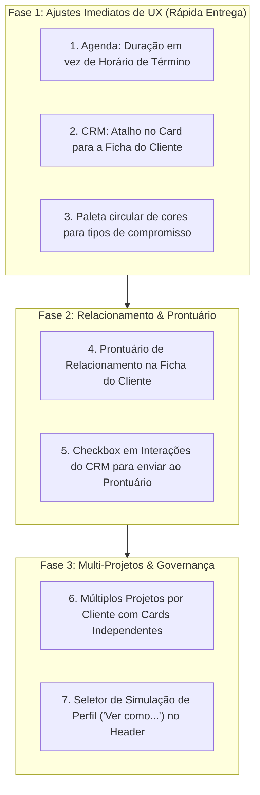

# Relatório Analítico de Implementação — Transcrições de Reuniões 📊

**Data de Emissão:** 22 de Outubro de 2026  
**Fontes Analisadas:**
1. `Reunião iniciada às 2026_10_08 21_00 GMT-03_00 - Anotações do Gemini.md` (Participantes: Thiago Aguiar, Rafael Porto, Leandro Mantovani)
2. `Reunião iniciada às 2026_10_15 11_38 GMT-03_00 - Anotações do Gemini.md` (Participantes: Leandro Mantovani, Rafael Porto)
**Local do Relatório:** `.agents/plans/reunioes/relatorio_status_reunioes_implementacao.md`

---

## 🧭 Sumário Executivo

O cruzamento detalhado entre as decisões registradas nas transcrições das reuniões e a base de código atual do repositório (**AdonisJS v7 + Lucid ORM + Inertia React 19**) demonstra um **alto índice de avanço nas entregas estruturais e de infraestrutura**, com a consolidação do monólito, o deploy automatizado no Railway, a parametrização dos 18 roteiros de briefing no banco e a nova matriz dinâmica de permissões.

Identificam-se, contudo, **pendências pontuais de usabilidade e fluxos de negócio** acordadas na reunião de 08/10 que ainda não foram convertidas em código (especialmente o ajuste de duração na agenda, o prontuário de observações do cliente, o atalho para a ficha de clientes a partir do CRM e a gestão de múltiplos projetos por cliente no Kanban).

---

## 📊 Matriz de Rastreabilidade e Status das Demandas

| # | Funcionalidade / Decisão | Reunião | Status | Onde está no código / Situação Técnica |
|:---:|:---|:---:|:---:|:---|
| **01** | **Transcrição dos Guias Técnicos de Briefing (18 Manuais em PDF)** | 08/10 | ✅ Implementado | Tabelas `roteiros_briefings` e `roteiro_briefing_ambientes`, seeder completo, gaveta `RoteiroAmbienteDrawer.tsx` e editor em `/configuracoes`. |
| **02** | **Relatório de Tempo por Etapa do Funil (Modal de Retenção e Gargalos)** | 08/10 | ✅ Implementado | `ModalDetalhesTempoFunil.tsx` e `TempoColunasPanel.tsx`. Gravação de `tempo_permanencia_segundos` com testes em `leads_tempo_colunas.spec.ts`. |
| **03** | **Remoção da Linha do Tempo da Sidebar Lateral para Modal Dedicado** | 08/10 | ✅ Implementado | `ModalCompromissosLead.tsx` e `CompromissosLeadPanel.tsx` no CRM. |
| **04** | **Matriz Dinâmica de Permissões e Perfis (Configurações)** | 08/10 | ✅ Implementado | Aba "Perfis & Permissões" em `/configuracoes`, tabela `perfil_permissoes`, `PermissionService.ts` e testes em `permissoes.spec.ts`. |
| **05** | **Regra de Inativação de Perfis vs Inativação de Colaboradores** | 08/10 | ✅ Implementado | Inativação de perfil mantém usuários legados; inativação de colaborador bloqueia autenticação e acesso imediatamente. |
| **06** | **Correção do Bug do Briefing Técnico (Ativação de Ambientes do Catálogo)** | 08/10 | ✅ Implementado | `briefings_controller.ts` e `ambientes_catalogo` sincronizados dinamicamente via `catalogos.ts`. |
| **07** | **Remoção do Campo Estilo Preferido no Briefing** | 08/10 | ✅ Implementado | Briefing simplificado para referências visuais e observações livres na Seção 2. |
| **08** | **Título de Compromisso Opcional (Assume o Tipo do Catálogo)** | 08/10 | ✅ Implementado | No backend e validação: título ausente assume automaticamente o nome do tipo (`agenda_controller.ts`). |
| **09** | **Unificação do Repositório em Monólito na Raiz** | 15/10 | ✅ Implementado | Monólito transferido da subpasta `plannit/` para a raiz `/`, pastas legadas `backend/` e `frontend/` eliminadas. |
| **10** | **Preparação para Deploy Contínuo no Railway App** | 15/10 | ✅ Implementado | `Dockerfile` multi-stage, `docker-entrypoint.sh` (com migrations automáticas) e `railway.toml`. |
| **11** | **Reset / Substituição do PostgreSQL no Railway** | 15/10 | ✅ Implementado | Documentado com procedimentos passo a passo em `docs/deploy/railway_deploy_guide.md`. |
| **12** | **Deploy Automático por Merge na Branch `main`** | 15/10 | ✅ Implementado | Branch `main` sincronizada e configurada com webhooks do Railway. |
| **13** | **Agenda: Data/Hora de Término ➔ Seletor de Duração (Estilo Google Agenda)** | 08/10 | ✅ Implementado | Criado `SeletorDataHoraDuracao.tsx` com data única, hora de início/fim sincronizadas com duração (`15m`, `30m`, `1h`, `1h30`, `2h`...), opção "Dia inteiro", chips de local e detector de conflitos de agenda em tempo real nos 3 modais (`ModalNovoCompromisso`, `ModalEditarCompromisso`, `ModalReagendarCompromisso`). |
| **14** | **Paleta de Cores Circular para Tipos de Compromisso** | 08/10 | ✅ Implementado | Paleta circular estilo Google Calendar (12 cores + roda de cor personalizada + preview ao vivo do badge) em `inertia/pages/configuracoes/index.tsx`. |
| **15** | **Atalho no Card/Drawer do CRM para Abrir a Ficha do Cliente** | 08/10 | 🔴 Pendente | Não há botão ou link direto dentro do `LeadCard` ou `LeadDrawer` em `crm/index.tsx` apontando para `/clientes/:id`. |
| **16** | **"Prontuário do Cliente": Observações Pessoais nas Interações** | 08/10 | 🔴 Pendente | A ficha do cliente (`clientes/show.tsx`) possui apenas campo geral de observações, sem área dedicada a fatos pessoais de encantamento (hobbies, família, pets). |
| **17** | **Associação de Múltiplos Projetos por Lead/Cliente (Cards Independentes)** | 08/10 | 🔴 Pendente | Iniciar briefing para lead existente atualmente reaproveita o mesmo projeto em aberto. Falta fluxo para criar novo projeto independente para o mesmo cliente. |
| **18** | **Seletor de Perfil no Header ("Ver como...") para Diretoria** | 08/10 | 🔴 Pendente | Header não possui mecanismo de alternância rápida de visualização para simular outros perfis (vendedor, projetista). |
| **19** | **Configuração de Domínio Próprio e DNS no Railway** | 15/10 | 🌐 Ação Externa | Aplicação utiliza domínio padrão do Railway (`.up.railway.app`). Aguarda definição de domínio corporativo pela liderança. |

---

## 🔍 Detalhamento do que Já Foi Implementado

### 1. Roteiros Técnicos de Briefing no Banco de Dados (Reunião 08/10)
- **O que foi pedido:** Transcrever os 18 manuais em PDF de ambientes da Líder Móveis para dentro do sistema, com perguntas estruturadas e respostas relacionadas.
- **Como foi entregue:**
  - Criação das tabelas relacionais `roteiros_briefings` (com seções dinâmicas em JSONB) e `roteiro_briefing_ambientes` (relação N:N, permitindo que um mesmo roteiro atenda múltiplos ambientes como "Quarto do Filho", "Quarto da Filha" e "Quarto de Visita").
  - Criação da gaveta lateral `RoteiroAmbienteDrawer.tsx` no Briefing, com inserção direta de títulos e itens na caixa de detalhamento do ambiente sem perda de rascunho.
  - CRUD administrativo completo com pesquisa e toggle na aba "Roteiros de Apoio" em `/configuracoes`.
  - Seeder com 100% dos dados dos 18 PDFs e suíte de testes em `roteiros_catalogo.spec.ts`.

### 2. Relatório de Permanência por Etapa do Funil (Reunião 08/10)
- **O que foi pedido:** Exibir o tempo total que o lead ficou no funil e porcentagens por etapa, identificando retornos e pontos de estagnação.
- **Como foi entregue:**
  - Criação de `ModalDetalhesTempoFunil.tsx` e `TempoColunasPanel.tsx`.
  - Backend registrando `tempo_permanencia_segundos` a cada mudança de status do lead.
  - Relatório visual com barras de progresso, indicação de maior retenção e dias/horas acumulados.

### 3. Matriz Dinâmica de Permissões & Perfis de Acesso (Reunião 08/10)
- **O que foi pedido:** Permitir que a Diretoria personalize permissões por perfil, ative/desative permissões específicas e crie novos perfis.
- **Como foi entregue:**
  - Tabela `perfil_permissoes` e `perfis_catalogo` com governança mestre irrevogável para Diretoria e `isSuperuser`.
  - Painéis `MatrizPermissoesPanel.tsx` e `UsuariosSistemaPanel.tsx` em Configurações.
  - 12 testes funcionais garantindo que inativação de perfil mantém usuários legados e exclusão só é permitida sem usuários associados.

### 4. Arquitetura Monolítica e Deploy Contínuo no Railway (Reunião 15/10)
- **O que foi pedido:** Resolver a divisão antiga de frontend/backend, consolidando em um monólito unificado na raiz e configurando o Railway.
- **Como foi entregue:**
  - Migração de `plannit/` para a raiz do repositório `/` e remoção total do legado (`backend/` e `frontend/`).
  - Criação do `Dockerfile` multi-stage em Node 24 Alpine, `railway.toml` e script `docker-entrypoint.sh` com migrations automáticas (`migration:run --force`).
  - Guia executivo de deploy e reset do banco em `docs/deploy/railway_deploy_guide.md`.

### 5. Agenda estilo Google Agenda + Paleta Circular de Cores (Reunião 08/10)
- **O que foi pedido:** Substituir o segundo campo manual de data/hora de término por seletor de duração estilo Google Agenda (`15m`, `30m`, `1h`, `1h30`, `2h`...), opção "Dia inteiro" e paleta circular de cores para Tipos de Compromisso.
- **Como foi entregue:**
  - Criação de `SeletorDataHoraDuracao.tsx` com seletor único de data, atalhos "Hoje"/"Amanhã", seletor de hora de início, seletor de hora de término com duração embutida (`13:00 (1 h)`), pílulas rápidas de duração, opção "Dia inteiro" (`08:00`–`18:00`) e verificador de conflito de agenda em tempo real.
  - Integração nos modais `ModalNovoCompromisso.tsx`, `ModalEditarCompromisso.tsx` e `ModalReagendarCompromisso.tsx`, além de chips rápidos de Local (`Showroom / Loja`, `Obra / Imóvel`, `Escritório Especificador`, `Reunião Online`).
  - Paleta circular de 12 cores + roda de cor personalizada e preview ao vivo do badge em `/configuracoes`.

---

## 📌 Detalhamento do que FALTA Implementar (Backlog Aberto)

Abaixo estão os **4 itens técnicos e de produto** que foram solicitados nas reuniões e ainda precisam ser desenvolvidos no código:

---

### Item 2: CRM — Atalho para a Ficha Completa do Cliente
- **Origem:** Reunião 08/10 (Minutos [00:12:48](#00:12:48) e [00:14:41](#00:14:41)).
- **Problema Atual:** No Kanban do CRM, quando o vendedor ou gestor clica em um card ou abre o drawer do lead, não há botão direto para abrir a ficha do cliente em `/clientes/:id`.
- **O que precisa ser feito:**
  1. No `LeadCard` e no cabeçalho do `LeadDrawer` em `inertia/pages/crm/index.tsx`, adicionar o botão/link **"Ver Ficha do Cliente ↗"**.
  2. Caso o lead já esteja convertido em cliente (`lead.clienteId`), abrir diretamente `/clientes/${lead.clienteId}` em nova aba ou navegação fluida.
  3. Caso o lead ainda não esteja convertido, abrir modal ou redirecionamento de visualização cadastral.

---

### Item 3: "Prontuário do Cliente" — Histórico de Observações Pessoais
- **Origem:** Reunião 08/10 (Minutos [00:11:04](#00:11:04) a [00:15:54](#00:15:54) — Thiago Aguiar).
- **Problema Atual:** Falta um local estruturado para registrar características pessoais e sutilezas do cliente pescadas durante as conversas (ex.: hobbies, nomes dos filhos, pets, preferências), voltado a estratégias de relacionamento e presentes pós-venda.
- **O que precisa ser feito:**
  1. **Na Ficha do Cliente (`/clientes/:id`):** Criar uma aba ou card destacado chamado **"Prontuário de Relacionamento"** contendo anotações livres em formato de timeline cronológica (autor, data e anotação).
  2. **No Modal de Nova Interação do CRM:** Adicionar um checkbox ou campo opcional: *"📌 Adicionar ao Prontuário do Cliente"*, permitindo que uma anotação feita no WhatsApp ou ligação seja gravada diretamente na ficha do cliente de forma automática.

---

### Item 4: Associação de Múltiplos Projetos para o Mesmo Cliente/Lead
- **Origem:** Reunião 08/10 (Minutos [00:23:03](#00:23:03) e [00:24:19](#00:24:19) — Thiago Aguiar).
- **Problema Atual:** Se um cliente que já fechou um projeto (ex.: Cozinha e Sala) volta à loja para fazer um novo ambiente (ex.: Quarto do Filho), o sistema atual tende a reaproveitar o projeto existente ou forçar a criação de um novo cliente duplicado.
- **O que precisa ser feito:**
  1. Permitir a criação de um **Novo Projeto** vinculado a um Cliente/Lead já existente.
  2. Cada projeto deve gerar seu próprio card independente no Kanban (com seu próprio status, valor, ambientes e SLA), permitindo que um projeto esteja em montagem e outro em fase de briefing simultaneamente.
  3. Na Ficha do Cliente (`/clientes/:id`), exibir a lista de todos os projetos vinculados (em andamento e concluídos).

---

### Item 5: Alternância de Perfil no Header ("Ver como...") para Diretoria
- **Origem:** Reunião 08/10 (Minutos [00:04:25](#00:04:25) e [00:05:28](#00:05:28) — Thiago Aguiar).
- **Conceito:** Permitir que o usuário com perfil `DIRETORIA` visualize a plataforma sob a ótica de outros perfis (Vendedor, Projetista, Conferente) para auditar permissões e visibilidade de tela sem precisar fazer logout e login com outras contas.
- **O que precisa ser feito:**
  1. No cabeçalho (`Header.tsx` em `app_layout.tsx`), ao lado do perfil da Diretoria, exibir um dropdown de simulação: *"Modo de Visão: [ Diretoria ▼ | Vendedor | Projetista | Gerente ]"*.
  2. O backend armazena o perfil simulado na sessão (`session.put('impersonate_perfil', perfil)`), ajustando as queries de isolamento e props compartilhadas do Inertia enquanto a simulação estiver ativa.
  3. Exibir banner de alerta no topo informando: *"Você está visualizando o sistema como Vendedor. [Restaurar Visão de Diretoria]"*.

---

## 🎯 Recomendações e Próximos Passos (Plano de Ação Sugerido)

Recomenda-se dividir as pendências nas seguintes fases de desenvolvimento:

1. **Prioridade 1 (Imediata):** Implementar o **Seletor de Duração na Agenda** e o **Atalho para a Ficha do Cliente no CRM** (itens simples de alto impacto diário).
2. **Prioridade 2:** Desenvolver o **Prontuário de Relacionamento do Cliente** integrado às interações.
3. **Prioridade 3:** Estruturar o suporte a **Múltiplos Projetos por Cliente** com cards independentes no Kanban e a simulação de perfil no Header.

